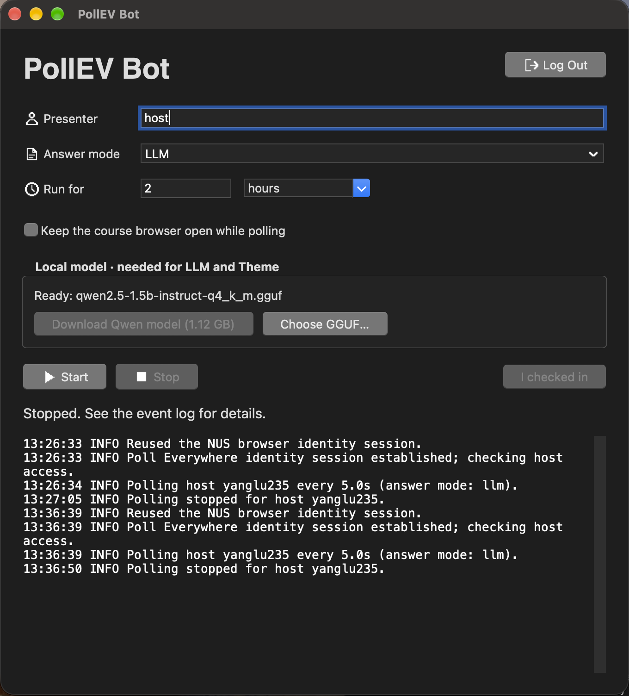

# PollEV Bot

A desktop app that watches a Poll Everywhere presenter and automatically answers supported multiple-choice and text activities. Built for NUS sign-in, with manual MFA and an optional local AI model.

<p align="center">
  
</p>

## Answer modes

| Mode | What it does |
| --- | --- |
| **LLM** | Answers visible questions with local AI. If an answer is unavailable, uses your optional fallback theme, or `yes.` if blank. MCQs fall back to a random option. |
| **Random** | Picks random MCQ options and replies `yes.` to text questions. No model needed. |

## Get started

You need **Google Chrome** and **Python 3.10+ with Tkinter**. Clone this repository and open a terminal in its folder.

### Apple Silicon Mac

With Homebrew installed:

```sh
brew install python@3.12 python-tk@3.12
python3.12 -m venv .venv
source .venv/bin/activate
CMAKE_ARGS='-DGGML_METAL=on' python -m pip install -r requirements-desktop.txt
python -m pollevbot.gui
```

After setup, you can also double-click **Launch PollEV.command**.

### Other computers

Use a Python installation with Tkinter:

```sh
python -m venv .venv
source .venv/bin/activate
python -m pip install -r requirements-desktop.txt
python -m pollevbot.gui
```

On Windows PowerShell, activate with `.venv\Scripts\Activate.ps1` instead. On Linux, Tkinter may need the `python3-tk` package. Installing the local AI dependency may require a C/C++ compiler.

**Only want Random mode?** Install `requirements-nus.txt` instead of `requirements-desktop.txt` to skip the AI dependency entirely.

## Using the app

1. Enter the **Presenter** name or full `pollev.com/host` URL.
2. Choose **LLM** or **Random** and how long to run. In LLM mode, optionally enter a **Fallback theme**: `NLP transformers` produces short topic phrases; `MCQ` produces an A–D letter reply for a text activity. You can specify `MCQ A or B` to limit the letters. Leave it blank for `yes.`.
3. For AI answers, click **Download Qwen model** once (about 1.12 GB), or **Choose GGUF** to select your own model. The download automatically selects the model. If the model is unavailable, responses still fall back to random MCQ choices and theme words or `yes.`.
4. Click **Start**. On your first run, use the course page's **Log in** flow in Chrome to complete NUS sign-in, MFA, and any respondent-name prompt. Leave Chrome open until the app confirms sign-in.
5. If the course requires check-in, complete it in Chrome, allow location if requested, then click **I checked in**.
6. Watch the updating status and activity logs. Click **Stop** to finish early.

Settings and login sessions are saved locally for your OS user; **no `.env` file is needed**. Use **Log Out** to clear the saved session. Models, settings, and browser caches are ignored by Git.

Keep your computer awake and connected to the internet. The Mac launcher prevents idle sleep while running, but closing the lid or manually sleeping still interrupts it.

The feed automatically retries connection failures. During a network interruption,
the status shows **Reconnecting** and keeps the last connected poll time; polling
resumes automatically when the connection returns.

Hidden questions use the configured fallback immediately. If a text form is still
loading, the bot prepares a reply and keeps retrying while that activity is active,
instead of giving up after three attempts. Chrome stays open while the form is
needed. A closed poll or pending check-in still needs an available response form;
confirmed and uncertain submissions are never sent twice.
